<!--
  프로필 README
  assets/scene.svg : 배경 전체 장면. 지글거림(WigglyPaint 스타일)은 SVG 안에서 재생됨. JS 없음.
-->

  

<!-- books:start -->

<a href="https://nuclyee72.github.io/ProjectDaily/#sudoku"></a><a href="https://nuclyee72.github.io/ProjectDaily/#sudoku"></a><a href="https://nuclyee72.github.io/ProjectDaily/#trilateral"></a><a href="https://nuclyee72.github.io/DailyWordship/"></a><a href="https://nuclyee72.github.io/ProjectDaily/#bwsweeper"></a><a href="https://nuclyee72.github.io/ProjectDaily/#farm"></a><a href="https://github.com/nuclyee72/mahjong_rating_site"></a><a href="https://nuclyee72.github.io/BWFlags/"></a><a href="https://nuclyee72.github.io/Gagedo/"></a><a href="https://nuclyee72.github.io/PPTSimulator/"></a><a href="https://nuclyee72.github.io/WMGame/"></a>

<!-- books:end -->
